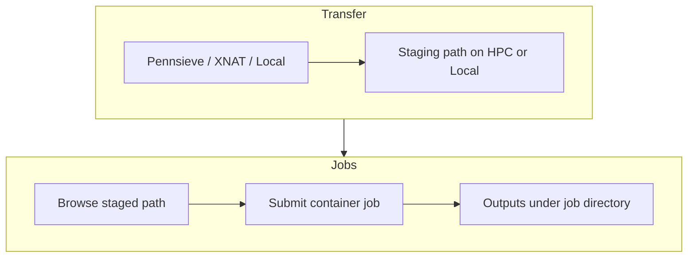

# How NeuroInsight works

NeuroInsight is an **orchestration layer** around containerized neuroimaging tools
(similar in spirit to how [QSIPrep](https://qsiprep.readthedocs.io) wraps diffusion
preprocessing — but NeuroInsight spans **many tools** and **where** they run).

You do not run command-line pipelines directly in the UI. You:

1. **Stage data** with **Transfer**  
2. **Submit compute** with **Jobs**  
3. **Monitor** logs and queue status  
4. Optionally **Transfer** results elsewhere  

---

## Core concepts

| Term | Meaning |
|------|---------|
| **Plugin** | One neuroimaging tool (e.g. FreeSurfer, fMRIPrep), defined in `plugins/*.yaml` |
| **Workflow** | Chained plugins with data passed between steps (`workflows/*.yaml`) |
| **Compute backend** | Where the container runs: **Local Docker**, **Remote Docker (SSH)**, or **HPC (SLURM + Apptainer)** |
| **Engine** | Desktop: Docker image `nir-allinone` with API + UI. Source: `./research start` |

Catalog of plugins/workflows: **Docs** tab in the app (generated from YAML).

---

## Transfer vs Jobs

### Transfer page

**Moves files** between:

- **Local** — your machine or the machine running the NeuroInsight engine  
- **Remote** — Linux host over SSH (Docker optional on that host)  
- **HPC** — cluster filesystem over SSH (same login you use for Jobs)  
- **Pennsieve** / **XNAT** — platform APIs (and Agent for Pennsieve uploads)  

Every route supports large-file behavior: timeouts, resume on download, skip
completed files on re-run. See the full matrix in [Transfer guide](TRANSFER.md).

### Jobs page

**Compute only.** You:

1. Choose **compute backend** (Local / Remote / HPC)  
2. **Browse** paths **on that backend** — the path must already exist there  
3. Pick a **plugin** or **workflow**  
4. Set resources (cpus, memory, GPU, time) when on HPC  
5. **Submit**  

There is **no** “pull from Pennsieve inside Jobs.” If data is on Pennsieve,
**Transfer → HPC (or Local)** first, then Jobs on the staged directory.

---

## Compute backends

| Backend | When to use | NeuroInsight does |
|---------|-------------|-------------------|
| **Local Docker** | Laptop/workstation with Docker Desktop | `docker run` plugin images; data under configured volumes |
| **Remote Docker** | Dedicated Linux analysis server | SSH + `docker` on remote |
| **HPC / SLURM** | Institutional cluster (e.g. URMC CIRC) | SSH + generated `sbatch` + Singularity/Apptainer images |

**Mac as orchestrator:** common pattern — heavy work on **HPC**, Mac runs Transfer + Jobs UI only. See [macOS notes](USER_GUIDE.md#macos-notes) in the user guide.

HPC requires:

- SSH access (password + MFA or keys per site)  
- Writable staging path (e.g. scratch)  
- Tool **license files** on the submit host when needed ([Tool licenses](TOOL_LICENSES.md))  

Implementation: `backend/execution/slurm_backend.py`, `local_docker_backend.py`, `remote_docker_backend.py`.

---

## What happens when you submit a job

1. NeuroInsight validates the plugin/workflow and input paths.  
2. Inputs are bound into a job workspace (layout depends on backend).  
3. A **container command** is built from the plugin YAML template.  
4. Backend starts the job (Docker locally, `docker` over SSH, or `sbatch` on HPC).  
5. Status, logs, and progress stream to the Jobs UI.  
6. Outputs appear under the job output directory on that backend — browse or **Transfer** them out.

Long jobs (FreeSurfer): allow hours and sufficient RAM in Customize or plugin defaults.

---

## Connectors (Pennsieve & XNAT)

- **Browse** and **download** use HTTPS APIs (downloads work on all architectures).  
- **Upload to Pennsieve** uses the **Pennsieve Agent** on the machine running the backend (bundled in amd64 desktop engine). See [Compatibility](COMPATIBILITY.md) for Apple Silicon.  
- **XNAT** may need tunnel/SSL options — [User guide — XNAT](USER_GUIDE.md#connecting-to-xnat).

Connectors are configured in the UI under **Transfer** / compute connection panels; credentials stay local (keychain on desktop).

---

## Desktop vs source

| Mode | Who |
|------|-----|
| **Desktop app** | End users — [Install](INSTALL.md) |
| **`./research start`** | Developers — [Engineering overview](ENGINEERING.md) |

Both use the same React UI and FastAPI backend contract.

---

## URMC clinical support

At URMC, NeuroInsight runs **Radiology support workflows** (structural MRI, lesion
detection, HS, multimodal epilepsy). It **does not** replace reads.
[Clinical support](CLINICAL_SUPPORT.md).

---

## Next steps

- [10-minute path](USER_GUIDE.md#10-minute-path)  
- [HPC pipeline input layouts](HPC_PIPELINE_SUBMISSION_GUIDE.md)  
- [Product scope & support](PRODUCT.md)
